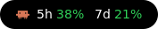
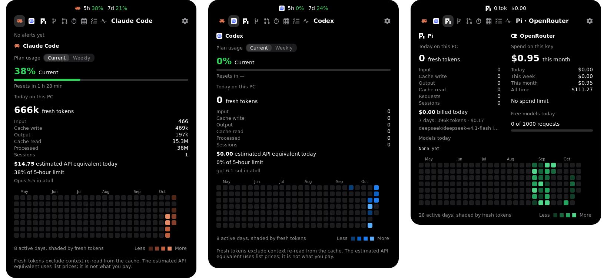

# Atoll

A floating "dynamic island" for your Linux desktop that shows how much of your AI coding agents' limits you've used: **Claude Code**, **Codex** and **Pi**. A small black pill shows the numbers at a glance. Click it to open a panel with details, plus a handful of developer tools.

[](https://github.com/donjordano/atoll/actions/workflows/ci.yml)
[](LICENSE)

<p align="center"></p>



## Why "Atoll"?

An atoll is a ring of small islands around a single lagoon. The project started as CCDI, short for "Claude Code Dynamic Island": a phone-style dynamic island for Claude Code. It got its new name when it grew into several agents sharing one pill: Claude Code, Codex and Pi, each a small island in the same ring. It also works as a short command: `atoll`.

## Features

- **The pill**
  - Shows the agent you selected last, with its logo:
    - Claude Code or Codex: 5-hour and weekly use.
    - Pi: today's tokens and cost.
  - Percentages turn green up to 50%, orange up to 80% and red above.
  - You can drag it anywhere on screen. It remembers the spot and stays on screen.
  - Click it to open or close the panel.
- **Claude Code tab**
  - Your plan limits, with a Current/Weekly toggle and reset times.
  - Today's tokens on this PC: input, cache write, output, cache read, and sessions.
  - What today's usage would cost at API list prices.
  - The model and project you used last.
  - A 26-week heatmap of activity.
- **Codex tab:** the same views, from Codex's own session logs.
- **Pi · OpenRouter tab**
  - Pi's tokens, what OpenRouter actually billed you, and the models you used today.
  - Your OpenRouter key's spending (today, this week, this month, all time).
  - How many of the day's free-model requests you've used.
  - A heatmap.
- **Claude Code alerts:** the pill turns orange when Claude Code needs your permission or input, and green when it finishes. This uses Claude Code hooks; see [Set up alerts](#set-up-claude-code-alerts).
- **Other tabs**
  - **Git:** branch, ahead/behind counts, changed files and recent commits for the project you used last.
  - **Pull requests:** your open PRs and PRs waiting for your review, via `gh`.
  - **Focus timer:** 25, 50 or 90 minutes, with a countdown in the pill.
  - **Calendar.**
  - **Tasks:** a to-do list saved on this PC.
  - **Activity:** CPU and memory graphs, plus Keep Awake, which stops the PC sleeping for 1h, 4h, 8h or until you turn it off.
- **Settings**
  - Turn each agent on or off.
  - Start at login.
  - Check whether the alert hooks are set up.
  - Reset the pill's position.

## Requirements

- Linux with **GNOME on X11**. It's tested on Pop!_OS 22.04 with GNOME 42. Wayland sessions are untested.
- Python 3.10 or newer, with PyGObject and GTK 3. These come with Ubuntu, Pop!_OS and Fedora Workstation.
- Optional:
  - Claude Code, Codex and Pi: whichever you want to track.
  - `git` for the Git tab.
  - `gh`, logged in, for the Pull requests tab.

## Install

On Debian, Ubuntu or Pop!_OS:

```sh
./packaging/build-deb.sh
sudo apt install ./dist/atoll_0.1.0_all.deb
atoll
```

You can also run it from the source folder without installing. [INSTALL.md](INSTALL.md) covers that, plus other distros, running at login and uninstalling.

## Set up Claude Code alerts

Add these hooks to `~/.claude/settings.json`. If you already have hooks for these events, add these entries next to them instead of replacing them.

```json
{
  "hooks": {
    "Notification": [{ "matcher": "", "hooks": [{ "type": "command", "timeout": 5,
      "command": "d=\"$HOME/.cache/atoll\"; mkdir -p \"$d\" && cat > \"$d/alert.$$\" && mv \"$d/alert.$$\" \"$d/alert\" 2>/dev/null || true" }] }],
    "Stop": [{ "hooks": [{ "type": "command", "timeout": 5,
      "command": "d=\"$HOME/.cache/atoll\"; mkdir -p \"$d\" && cat > \"$d/alert.$$\" && mv \"$d/alert.$$\" \"$d/alert\" 2>/dev/null || true" }] }],
    "UserPromptSubmit": [{ "hooks": [{ "type": "command", "timeout": 5,
      "command": "d=\"$HOME/.cache/atoll\"; mkdir -p \"$d\" && cat > \"$d/alert.$$\" && mv \"$d/alert.$$\" \"$d/alert\" 2>/dev/null || true" }] }]
  }
}
```

Each hook writes Claude Code's event to `~/.cache/atoll/alert`, and Atoll checks that file once a second. Settings → *Claude Code alerts* shows whether the hooks are found.

## Where the numbers come from

| Data | Source | Network |
|---|---|---|
| Claude Code plan limits | `https://api.anthropic.com/api/oauth/usage`, using the token Claude Code keeps in `~/.claude/.credentials.json` | Every 90 s at most, waiting at least 5 min after errors |
| Claude Code tokens | `~/.claude/projects/**/*.jsonl` | none |
| Codex limits and tokens | `~/.codex/sessions/**/*.jsonl` | none |
| Pi tokens and cost | `~/.pi/agent/sessions/**/*.jsonl` | none |
| OpenRouter spending | `https://openrouter.ai/api/v1/key`, using the key in `~/.pi/agent/auth.json` or `$OPENROUTER_API_KEY` | When the Pi tab is open, at most once a minute |
| Pull requests | `gh search prs` | When the tab is open, at most every 2 min |

Things to know:
- **The Claude usage endpoint isn't a documented public API.** Anthropic can change or remove it at any time.
- **Codex limits are only as fresh as Codex's last session on this PC**, because Atoll reads them from the session logs.
- **Cost estimates use list prices**, hardcoded in `atoll/core/pricing.py`. They aren't what you're billed on a subscription.
- **Pi's cost is real**: it's the amount OpenRouter reports billing you.

Atoll never sends your tokens or keys anywhere except the service they belong to, and it doesn't save them.

## Your data

Everything Atoll saves stays on your PC:

- `~/.local/share/atoll/`: daily history for the heatmaps, last plan limits, tasks, agent switches and the pill's position.
- `~/.cache/atoll/`: the alert file the hooks write.
- `~/.config/autostart/atoll.desktop`: only if you turn on *Start at login*.

Agent session logs get deleted over time, so Atoll keeps its own daily totals so older heatmap days don't disappear.

## Contributing

Bug reports, ideas and pull requests are welcome. Please read [CONTRIBUTING.md](CONTRIBUTING.md) first, and follow the [Code of Conduct](CODE_OF_CONDUCT.md). To report a security issue, see [SECURITY.md](SECURITY.md).

## License

[MIT](LICENSE). Logos come from [Lobe Icons](https://github.com/lobehub/lobe-icons), also MIT; see [atoll/icons/SOURCE.txt](atoll/icons/SOURCE.txt).

Atoll is an independent project. It isn't affiliated with or endorsed by Anthropic, OpenAI, OpenRouter or the Pi project. Claude, Claude Code, Codex and the other names and logos belong to their owners.
